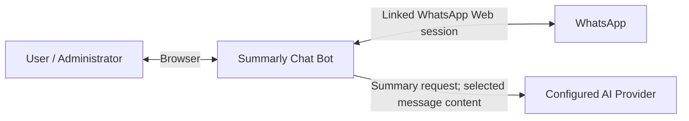
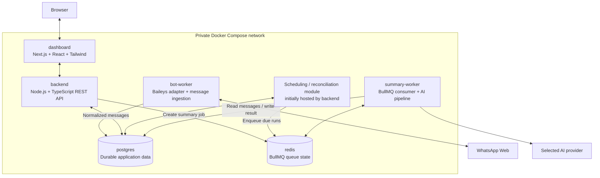
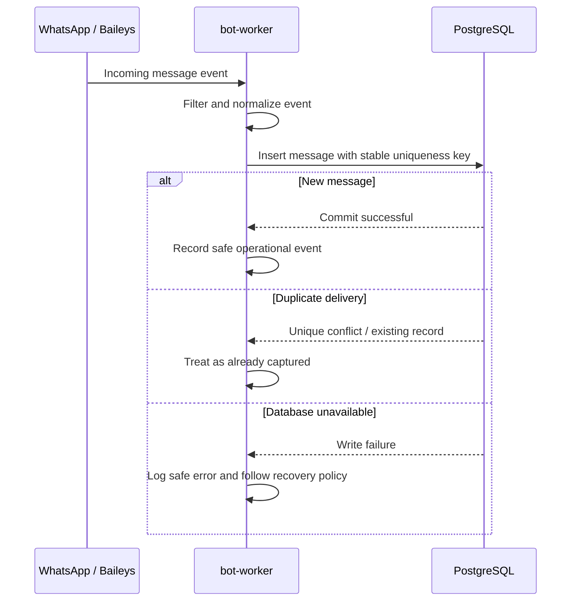

# Summarly Chat Bot — Architecture

- **Status:** Proposed architecture for the initial MVP; not all components are implemented.
- **Deployment target:** Self-hosted, single installation, Docker Compose.
- **Last reviewed:** 2026-10-29.

This is a living design document. Keep it aligned with the code. Mark decisions as **Decided**, **Proposed**, or **Open** rather than presenting assumptions as implemented facts. For significant changes, add or update an Architecture Decision Record (ADR) under `docs/decisions/`.

## 1. Purpose and goals

Summarly captures authorized messages from selected WhatsApp groups and generates structured daily summaries that help users find key discussions, confirmed decisions, unresolved questions, tasks, and links.

The architecture aims to:

1. Be straightforward to install, operate, back up, and update on a user's own machine or server.
2. Store durable business data in PostgreSQL.
3. Keep slow or failure-prone AI work outside interactive HTTP requests.
4. Isolate WhatsApp and AI-provider integrations behind replaceable adapters.
5. Handle duplicate events, retries, process restarts, and partial failures deliberately.
6. Minimize collection, retention, and exposure of private conversation data.
7. Demonstrate sound engineering without adopting unnecessary distributed-system complexity.

### Non-goals for the MVP

- A SaaS multi-tenant platform or multi-host orchestration.
- Kubernetes or service meshes.
- A vector database or semantic search.
- Media/audio transcription and image understanding.
- Supporting many AI providers before one provider contract works end to end.
- Queueing each incoming message through Redis before persisting it, unless measured requirements justify it.

## 2. Context and external dependencies

Summarly is installed and administered by the user. It interacts with a linked WhatsApp Web session, a user-selected AI provider, and the local browser.

### External dependency constraints

- **WhatsApp / Baileys:** Baileys is an unofficial WhatsApp Web integration. It is not an official WhatsApp API, and upstream protocol or account restrictions can disrupt compatibility. Keep it isolated, test reconnection behavior, and describe the limitation honestly in user documentation.
- **AI provider:** selected message content is sent to the configured provider for summarization. The provider's current data handling, retention, region, and account terms apply. Do not promise zero retention without verifying the actual provider and configuration.
- **Network availability:** the app must report disconnections and provider failures clearly. It must not mark a summary complete when its result was not durably saved.

## 3. Container view

The first deployment is a modular application split into a few processes for lifecycle and workload isolation. It is not intended to be a fleet of independently scaled microservices.

Only the required dashboard/backend entry point should be published to the host. PostgreSQL and Redis should remain on the private Compose network unless an explicit, documented operational need requires otherwise. The scheduler is initially a module in the backend process; it may become a separate process only if operating requirements justify it.

## 4. Building blocks and responsibilities

### 4.1 `dashboard`

**Planned stack:** Next.js App Router, React, TypeScript, Tailwind CSS.

Responsibilities:

- Display connection and group status.
- Let the administrator select monitored groups and configure summary preferences.
- Configure the AI provider and model without exposing saved secrets again.
- Request a summary for a group and time period.
- Show pending, processing, completed, and failed states; show history and source references when available.
- Communicate with the backend API only. The browser must never connect directly to PostgreSQL or Redis.

The dashboard may be served locally in the MVP. If accessible from another device or an untrusted network, authentication, authorization, and a secure transport configuration are required before that deployment is considered safe.

### 4.2 `backend`

**Planned stack:** Node.js, TypeScript, Fastify REST API, Zod, `pg` PostgreSQL access layer (stack decided — see `docs/decisions/0001`).

Responsibilities:

- Validate requests and enforce the selected authentication/authorization model.
- Manage application settings and monitored-group configuration.
- Provide APIs for connection status, summary requests, summary status, and summary history.
- Create durable `summary_run` records in PostgreSQL.
- Enqueue summary jobs with BullMQ.
- Host the initial scheduling and reconciliation module.

The backend must not own the live Baileys socket or import socket details into request handlers. Keep WhatsApp operations in `bot-worker` and talk through defined data/status boundaries.

### 4.3 `bot-worker`

**Planned stack:** Node.js, TypeScript, Baileys.

Responsibilities:

- Own the linked WhatsApp session and its lifecycle.
- Isolate Baileys events and APIs in a dedicated adapter.
- Handle connection state, expected disconnects, reconnection, and graceful shutdown.
- Receive supported incoming messages and normalize them into an internal message contract.
- Persist messages in PostgreSQL and handle duplicate delivery safely.
- Provide connection status without exposing authentication material.

For the MVP, focus on text messages and links. Define behavior for unsupported event types. Keep WhatsApp session state in protected persistent storage; exclude it from Git, logs, API responses, and static files.

### 4.4 `summary-worker`

**Planned stack:** Node.js, TypeScript, BullMQ, PostgreSQL access layer, AI-provider adapter, Zod.

For a `generate-summary` job, it should:

1. Validate the payload and load the durable `summary_run` record.
2. Fetch messages from PostgreSQL for the requested group and interval.
3. Order messages deterministically and handle empty periods.
4. Split large conversations into context-sized chunks when needed, and consolidate results while preserving source references when feasible.
5. Call the configured provider with conversation messages treated as untrusted data, separate from system instructions.
6. Validate the response against a defined result schema.
7. Persist the summary and final run status in PostgreSQL.
8. Distinguish retryable errors (for example, a temporary rate limit) from permanent errors (for example, invalid provider configuration).

Use bounded concurrency and provider-aware rate limits. Queue payloads should contain identifiers and a time range—not full messages, API keys, or session secrets.

### 4.5 PostgreSQL

PostgreSQL is the durable source of truth for application and business state. Logical entities (names are provisional) include:

- `whatsapp_connections`: connection metadata and non-secret status.
- `groups`: monitored groups, timezone, and preferences.
- `messages`: normalized messages and stable provider identifiers.
- `summary_runs`: a request for a given group and period, status, attempts, timestamps, and safe error metadata.
- `summaries`: validated output, provider/model metadata, and source references.
- `ai_provider_configs`: provider preferences and, only if needed, encrypted user-supplied credentials.

The final table schema, indexes, migration tool, retention behavior, and exact uniqueness keys belong in the data model and migration design. Enforce uniqueness for incoming messages and summary-run identity in the database, not only in application memory.

### 4.6 Redis and BullMQ

BullMQ provides the queue API and job lifecycle behavior; Redis stores queue state. Redis is **not** the authoritative store for messages or completed summaries.

Initial design:

- Queue: `summaries`.
- Job: `generate-summary`.
- Payload: durable `summaryRunId` (preferred) plus only minimal identifiers required by the worker.
- Retry: finite retry limit with backoff for retryable errors.
- Concurrency: bounded and configured with provider limits in mind.
- Retention: configure removal/retention of completed and failed BullMQ jobs deliberately to prevent unbounded queue-state growth while preserving business history in PostgreSQL.
- Persistence: use a named Docker volume and an appropriate Redis persistence configuration; this reduces, but does not eliminate, the need for recovery/reconciliation logic.

Do not add incoming-message ingestion to this queue in the MVP. `bot-worker` writes messages directly to PostgreSQL first. Consider a separate ingestion queue only if measurements show sustained database bottlenecks or a clear need to absorb bursts.

## 5. Critical runtime flows

### 5.1 Capture an incoming message

A message is considered durably captured only after PostgreSQL commits the insert. If persistence fails, do not log the message body as a workaround or report it as stored. The exact retry/recovery policy for an outage during live capture must be tested and documented; Baileys event delivery must not be assumed to provide unlimited replay of missed messages.

### 5.2 Request a manual summary

1. The dashboard sends a request to the backend.
2. The backend validates access, group ID, and requested interval.
3. The backend creates or finds the unique `summary_run` record in PostgreSQL.
4. It enqueues a BullMQ job referencing that run.
5. The API returns the run ID and status instead of waiting for the complete AI request.
6. `summary-worker` loads messages, generates and validates output, and commits the summary and final run state.
7. The dashboard reads status and result through the API.

### 5.3 Schedule daily summaries

1. The scheduler identifies groups due for a summary.
2. It computes a period using an explicit IANA timezone and a half-open interval: start inclusive, end exclusive.
3. It inserts or reuses a unique `summary_run` record in PostgreSQL.
4. It enqueues the run in BullMQ.
5. The `summary-worker` processes it using the same pipeline as a manual request.

Choose the default timezone and cutoff in product requirements. Never rely on the host's local timezone. The scheduling implementation must avoid duplicate runs after restarts and, if replicas are ever introduced, duplicate scheduling across replicas.

## 6. Reliability, consistency, and recovery

PostgreSQL and Redis do not share a normal atomic transaction. The design must account for PostgreSQL committing a run while enqueueing fails, and for enqueueing succeeding while the caller loses its response.

For the MVP:

- Create a durable `summary_run` before attempting to enqueue it.
- Give each group/period/run a stable identity and protect it with a database uniqueness constraint.
- Make processing and final writes idempotent.
- If enqueueing fails, leave the run in a recoverable state in PostgreSQL.
- Run a reconciliation pass that finds eligible pending/stuck runs and safely enqueues them again.
- If a job is repeated after the AI call but before a successful database commit/acknowledgment, do not create a duplicate completed summary.
- Apply finite retries and record a safe terminal error when retries are exhausted.
- Provide an explicit retry path for failed runs.
- Handle graceful shutdown of the WhatsApp socket, workers, queue connections, and database pool.

A transactional outbox may provide stronger delivery guarantees later. Do not add it to the MVP unless the simpler durable-run-plus-reconciliation design proves insufficient.

## 7. AI provider interface and summary correctness

The application should depend on a provider-neutral interface, not directly on one vendor SDK throughout the codebase. Start with one real provider and a mock adapter for tests.

The interface should support typed input and output, validated provider/model configuration, timeouts, rate-limit handling, malformed-response handling, and usage metadata when available.

Summary design principles:

- Distinguish confirmed decisions from proposals and unresolved questions.
- Do not invent an owner, due date, agreement, or action item not supported by the messages.
- Preserve source references for important claims where practical.
- Validate generated structures before rendering Markdown.
- Test using synthetic conversations that include ambiguity, contradictory statements, malicious prompt-injection attempts, and empty periods.
- Make it clear that output is AI-generated and should be checked against source messages for consequential decisions.

If the dashboard saves user-supplied API keys, use authenticated encryption server-side and keep the master key outside the database. Do not return plaintext keys to the browser. Provider data policies apply to any message content sent for inference.

## 8. Security and privacy principles

- Keep the default deployment local/private and expose only the required application endpoint.
- Do not publish PostgreSQL or Redis ports to the host by default.
- Protect WhatsApp session state and exclude it, `.env`, private chat fixtures, and database dumps from Git.
- Provide `.env.example` with safe placeholders only.
- Authorize every operation that reads or mutates messages, groups, connection settings, or summaries.
- Treat chat content, attachments, imported data, and AI output as untrusted.
- Avoid logging message bodies, API keys, tokens, and session credentials.
- Define retention, deletion, export, and backup protection before calling the deployment production-ready.
- If remote access is supported, document the supported authentication model and HTTPS/reverse-proxy requirements.

## 9. Deployment and operations

The initial Docker Compose deployment contains:

- `dashboard`
- `backend`
- `bot-worker`
- `summary-worker`
- `postgres`
- `redis`

Use persistent named volumes for PostgreSQL, Redis queue state, and WhatsApp session state. Internal services should use Compose service DNS names and remain on the private network. Secrets must be injected through protected environment/configuration mechanisms, never baked into images.

Before a stable release, document and test:

- Fresh installation and required environment variables.
- Readiness/health checks (not just container process existence).
- Database migrations and rollback/recovery expectations.
- Backup and restore.
- Upgrade steps and compatibility expectations.
- Where operational logs are stored and how to diagnose a stuck summary.
- Graceful shutdown and restart behavior.

Use structured operational logs with timestamps, service, run/job IDs, and error category. Do not include sensitive message content or secrets by default. Keep queue job retention bounded, while preserving durable run history in PostgreSQL.

## 10. Quality goals and trade-offs

| Quality goal | Architectural response | Trade-off / validation |
|---|---|---|
| Self-hosting simplicity | Docker Compose; a small fixed set of services | More containers than a single-process app; test a clean install. |
| Data durability | PostgreSQL for messages and summary history | Queue insertion is not atomic with a DB transaction; use reconciliation. |
| Recoverability | Idempotent jobs, finite retries, persisted run identity | A job may execute more than once; verify duplicate-safe writes. |
| Privacy | Private network defaults, protected sessions, minimal logging | Operators still control backups and provider selection; document responsibilities. |
| Maintainability | Adapters and explicit service boundaries | Avoid abstractions that do not yet address a real variation. |
| Summary trustworthiness | Structured output validation and source references | LLM output can still be wrong; test and communicate uncertainty. |
| Portability | Environment-based configuration and documented volumes | Provider and Baileys compatibility can vary; pin and test versions. |

## 11. MVP boundaries

### Include

- One self-hosted installation with a clearly documented initial administration model.
- Baileys session lifecycle and authorized group monitoring.
- Text messages and links.
- PostgreSQL persistence and duplicate prevention.
- Manual summary generation before automatic scheduling.
- One real AI provider behind the shared interface, plus a mock provider for tests.
- BullMQ jobs with finite retries, bounded concurrency, and safe reprocessing.
- Daily summaries after the manual flow is reliable.
- Dashboard showing connection/group state and summary history.
- Automated tests, Docker Compose setup, migration path, and installation documentation.

### Defer

- Media ingestion, image interpretation, and audio transcription.
- Many providers before the first adapter is proven.
- SaaS multi-tenancy and sophisticated role systems.
- Kubernetes, multi-host orchestration, and service mesh.
- Vector search and retrieval-augmented generation.
- Redis queueing for each inbound message without evidence it is needed.

## 12. Decisions to record before or during implementation

Use short ADRs under `docs/decisions/` for decisions with meaningful trade-offs. Initial topics:

1. **Stack and repository structure:** workspace/package manager, HTTP framework, database access library, migration tool, test runner.
2. **WhatsApp integration:** Baileys version, supported event types, session storage, reconnection and recovery limitations.
3. **Queue strategy:** Redis/BullMQ configuration, retry policy, job retention, reconciliation strategy, criteria for considering a transactional outbox.
4. **Summary semantics:** supported output sections, source references, period boundaries, timezone defaults, empty periods and regeneration behavior.
5. **Secrets and authentication:** initial administrator/access model, key storage, encryption master key, remote access constraints.
6. **Retention and backups:** message retention default, deletion behavior, backup encryption, restore procedure.

Recorded so far: `docs/decisions/0001-stack.md` (topic 1, decided) and
`docs/decisions/0002-admin-authentication.md` (topic 5, initial model decided;
key-encryption master key still open).

Do not block small implementation tasks on documenting every future decision. Record decisions before they become hard to reverse and update this document when the implemented design diverges.

## References

- [OpenCode project instructions](https://dev.opencode.ai/v2/docs/instructions/) — concise, repository-specific instructions and their scope.
- [GitHub: How to write a great AGENTS.md](https://github.blog/ai-and-ml/github-copilot/how-to-write-a-great-agents-md-lessons-from-over-2500-repositories/) — concrete commands, boundaries, and verification guidance.
- [C4 model diagrams](https://c4model.com/diagrams) — context, container, component, and code views; most teams can start with context and container diagrams.
- [arc42 overview](https://arc42.org/overview/) — adaptable architecture documentation covering goals, constraints, building blocks, runtime, deployment, decisions, quality requirements, and risks.
- [BullMQ documentation](https://docs.bullmq.io/) — queue, worker, retry, and operational behavior.
- [Baileys repository](https://github.com/WhiskeySockets/Baileys) — current integration documentation and compatibility caveats.
